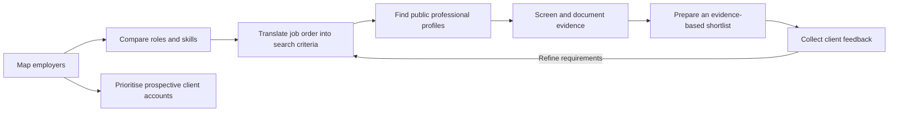
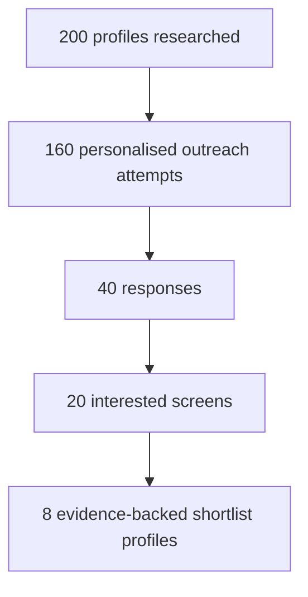

<div align="center">

# Talent Market Mapping & Recruitment Research

### Turning employer research into practical recruitment and business-development decisions

**Enterprise AI · GenAI · SaaS | India | October 2026**

   

*A research-led recruitment case study built to demonstrate how a consultant could understand a client's job order, map relevant employers, source potential candidates, and identify prospective client accounts.*

</div>

---

## At a glance

| **44** employers mapped | **7** role families | **21** skills evaluated | **10** prospective accounts ranked |
|:---:|:---:|:---:|:---:|
| India-focused company database | Role-to-skill comparisons | Screening priorities | Weighted, provisional client fit |

> [!IMPORTANT]
> This is **independent desk research and a simulated recruitment assignment**, not a record of candidates placed, clients signed, or live searches completed. Company-to-role matches are research judgments, **not confirmed vacancies**. Hiring information may change after the dates captured in the workbook.

## The problem

A recruiter cannot start with a job title alone. A request for a “GenAI Engineer” might mean an LLM researcher, a Python backend engineer who has built RAG workflows, or a product-focused engineer shipping AI features. Each interpretation produces a different candidate pool.

I built this project to answer four practical questions:

1. **Where should I look?** Which employers operate in relevant talent markets?
2. **Who should I search for?** Which role requirements are genuinely essential versus desirable?
3. **How would I qualify a profile?** What evidence should appear in an initial screen?
4. **Which companies may need recruitment support?** How can employer research guide business development?

## Research-to-recruitment workflow



*The sourcing, screening and client-feedback stages above describe the proposed operating workflow; they are not represented as completed placements.*

## What's in the Excel workbook?

The workbook is the project's primary research deliverable. Open **`Talent_Market_Mapping(1).xlsx`** (rename the supplied workbook to this filename when uploading) and use these tabs:

| Worksheet | What it contains | Recruitment use |
|---|---|---|
| **README** | Workbook navigation and definitions | Understand the model |
| **Companies** | 44 employers, segments, India hubs, relevant roles, hiring fields and fit scores | Build target-employer lists |
| **Roles & Skills** | 7 role families, typical titles and a 21-skill comparison | Create role-specific search criteria |
| **Job Order** | Illustrative Associate GenAI Engineer request and assessment criteria | Separate must-haves from preferences |
| **Sourcing Strategy** | Search channels, keywords, Boolean search and qualification approach | Plan candidate discovery |
| **Insights** | Formula-driven employer and role summaries | Interpret patterns in the selected sample |
| **Client Prospects** | Provisional top-10 employer ranking and outreach angles | Prepare account research |
| **Assumptions** | Scoring weights and model inputs | Audit the ranking logic |
| **Market Report** | Executive-style observations and recruiting implications | Communicate insights |
| **Sources** | Research evidence log and links | Check provenance and freshness |
| **Resume Bullets** | Suggested project descriptions | Present work accurately |

### Roles covered

| Code | Role family | Example screening focus |
|:---:|---|---|
| R1 | GenAI / LLM Engineer | Python, hands-on LLM applications, RAG, API delivery |
| R2 | ML Engineer / MLOps | Deployment, pipelines, model monitoring |
| R3 | Data Scientist | Statistics, Python/SQL, experiment design |
| R4 | Data Engineer | SQL, ETL/ELT, orchestration and cloud data stacks |
| R5 | ServiceNow Developer | Platform configuration, workflows, ITSM concepts |
| R6 | AI Product Manager | Product requirements, evaluation metrics, stakeholder alignment |
| R7 | Solutions Consultant / Pre-sales | Solution discovery, demos, technical communication |

*The table highlights illustrative screening themes; consult the workbook for the full role-by-skill matrix.*

## Case simulation: Associate GenAI Engineer

**Client:** hypothetical B2B SaaS company · **Location:** Bengaluru (hybrid) · **Experience:** approximately 1–3 years · **Illustrative demand:** 2 positions

| Must-have evidence | Preferred evidence |
|---|---|
| Practical Python development | LangChain / LlamaIndex exposure |
| Built an LLM-powered application | LLM evaluation and quality measurement |
| Hands-on retrieval-augmented generation (RAG) | Fine-tuning / LoRA / PEFT familiarity |
| REST APIs and basic deployment capability | Docker / CI/CD and SaaS product context |

A shortlist should be based on *what someone built and personally owned*, not merely whether their profile contains “AI” or a popular framework name. Salary range, notice-period limit, interview stages and final non-negotiables must be confirmed with the client before an actual search.

### Example candidate search

```text
("GenAI" OR "LLM Engineer" OR "Generative AI" OR "AI Engineer")
AND Python
AND (RAG OR "retrieval augmented generation" OR LangChain OR "vector database")
AND (Bengaluru OR Bangalore)
```

**Discovery channels:** approved internal database and referrals first; then LinkedIn, company career pages, public GitHub portfolios and relevant job boards. Searches should be adjusted to each channel's syntax and available filters.

**Screening checklist:** confirm the candidate's interest, relevant delivery experience, location/hybrid preferences, compensation expectations, availability and permission to share their profile. Capture objective evidence and unresolved questions in structured notes, following applicable SOPs and privacy requirements.

### Illustrative recruitment funnel — *targets, not actual results*



These quantities are hypothetical planning inputs intended to explain recruiter throughput and prioritisation; **no outreach or placement outcome is claimed**.

## Selected findings and business implications

- **Location concentration:** Bengaluru is the primary mapped India hub for **20 of 44** companies (approximately **45%**). This describes the selected research sample, not the overall Indian job market.
- **Role relevance:** **39** mapped employers were associated with ML/MLOps roles and **38** with GenAI/LLM Engineering. These are likely role matches, **not validated open-position counts**.
- **Client research:** The model currently places **Deloitte (4.05)**, **Accenture (4.03)** and **Cognizant (3.85)** at the top of the provisional client-fit ranking. A score is a prioritisation hypothesis, **not evidence of commercial opportunity or agency engagement**.
- **Recruitment implication:** Search for demonstrable implementation skills (production APIs, retrieval quality, deployment ownership) instead of treating generic AI keywords as proof of fit.

### Turning research into a client conversation

> “I mapped employers and role requirements across India's enterprise AI market, particularly Python, RAG and production-oriented AI engineering. Which parts of your current hiring pipeline are hardest to fill, and would a role-specific talent snapshot be useful?”

For actual business development, validate an employer's current requirements, procurement/vendor rules and relevant contact information before approaching them.

## How to use this repository

1. Download or clone this repository and open the Excel workbook in **Microsoft Excel**.
2. Start with **README → Companies → Roles & Skills** to see how employers and target capabilities are connected.
3. Review **Job Order** and **Sourcing Strategy** to see how research turns into search criteria and an initial screening plan.
4. Review **Insights → Client Prospects → Assumptions** to understand and challenge prioritisation scores.
5. Use **Sources** to validate evidence and recheck time-sensitive hiring information before making an external claim.
6. Read the two-page **RGF case study PDF** for a concise narrative of the work.

**Suggested repository layout** (rename the workbook and report to match these names):

```text
Talent-Market-Mapping/
├── README.md
├── Talent_Market_Mapping(1).xlsx
└── report.pdf
```

No Python environment or installation step is required. This is an **Excel-based research project**, not a web scraper or automated applicant-tracking system.

## Methodology, assumptions and limitations

**Method:** targeted desk research, employer categorisation, role/skill mapping, formula-driven aggregation, a sample job order and weighted prospective-client scoring. The workbook keeps model assumptions and external links in dedicated worksheets.

**Caveats:** This is a purposive sample of 44 companies; it is not statistically representative. Company size, likely roles, willingness to work with agencies and client-fit values include estimates. Some hiring fields and sources are time-sensitive; individual links may be third-party listings rather than official company confirmations. Always verify critical claims directly against company careers pages and date-stamp any updates. Do not infer that a person is actively seeking work solely because their public profile matches a search.

**Ethical use:** Use only lawfully accessible professional information, avoid collecting unnecessary personal data, respect site terms and candidate privacy, and do not forward profiles without appropriate permission.

## Deliverables

- **Excel workbook:** employer mapping, roles/skills, sample job order, sourcing plan, insight tables, client prioritisation, assumptions and evidence log.
- **Two-page PDF:** succinct, interview-friendly case study of the recruitment research approach.

---

<div align="center">

**Built as an independent recruitment research portfolio project.**  
*Research is useful when it changes a decision: where to search, what to screen, which client to approach, or how to improve after feedback.*

</div>
